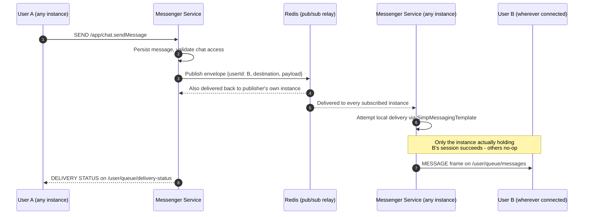
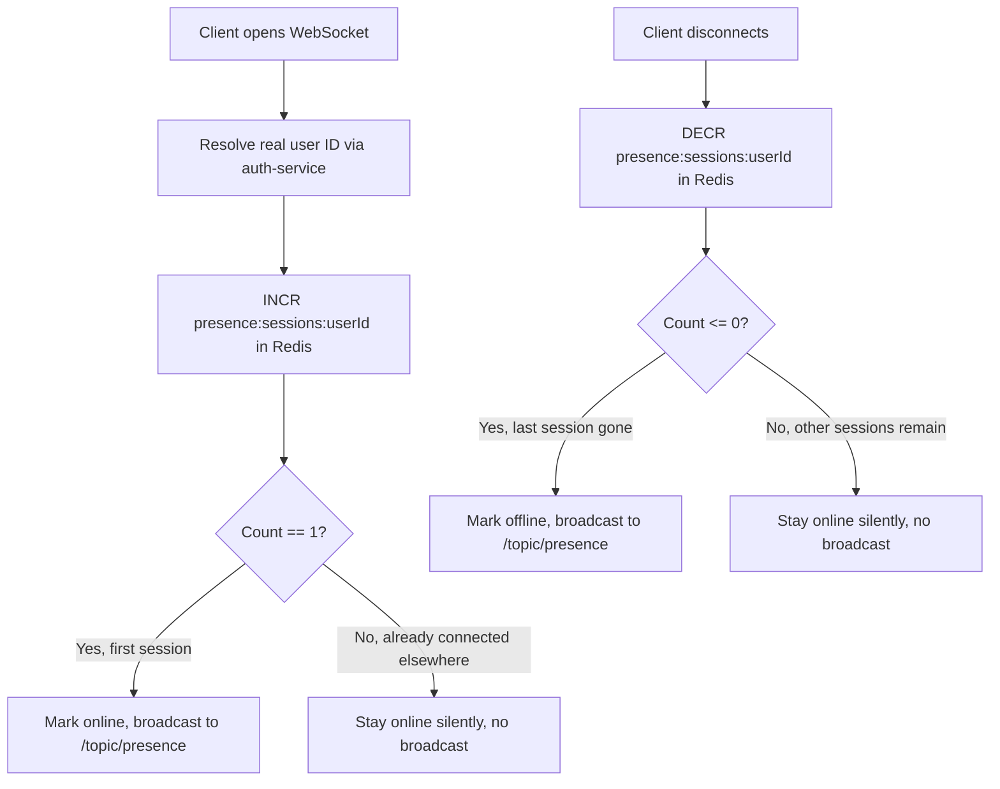

<p align="center">
  
</p>

<h1 align="center">Premisave Messenger Service: Real-Time Chat &amp; Presence API</h1>

<p align="center">
  <b>A production-minded Spring Boot 4 &amp; MongoDB microservice powering real-time 1:1 and group messaging for the Premisave platform — WebSocket/STOMP delivery, Redis-relayed for correct behavior across multiple instances, with live presence, typing, delivery, and read-receipt tracking.</b>
</p>

<p align="center">
  <a href="https://github.com/peacemakerbill">
    
  </a>
  <br/>
  <sub>Built by <a href="https://github.com/peacemakerbill"><b>Bill Graham Peacemaker</b></a> (<code>@peacemakerbill</code>) · Backend Developer &amp; API Support Engineer · Nairobi, Kenya</sub>
</p>

<p align="center">
  
  
  
  
  
  
  
  
</p>

<p align="center">
  <a href="https://github.com/peacemakerbill/premisave-messenger-service/stargazers"></a>
  <a href="https://github.com/peacemakerbill/premisave-messenger-service/network/members"></a>
  <a href="https://github.com/peacemakerbill/premisave-messenger-service/issues"></a>
  <a href="https://github.com/peacemakerbill/premisave-messenger-service/commits"></a>
  
  
  
</p>

<p align="center">
  <a href="#quick-start">Quick start</a> ·
  <a href="#architecture">Architecture</a> ·
  <a href="#how-real-time-delivery-works">Real-time delivery</a> ·
  <a href="#how-presence-tracking-works">Presence</a> ·
  <a href="#calls-and-recordings">Calls</a> ·
  <a href="#run-it-with-docker-and-deploy-it">Docker</a> ·
  <a href="#api-reference">API reference</a> ·
  <a href="#configuration-reference">Configuration</a> ·
  <a href="#troubleshooting">Troubleshooting</a>
</p>

> **If this saves you time building real-time chat with Spring and STOMP, please star the repo.** It helps other developers find a working, horizontally-scalable reference implementation.

> **Disclaimer.** This is an independent, community-built project shared as a portfolio and reference implementation. It is not affiliated with or endorsed by any third party mentioned here. Always follow your own provider's current documentation for production credentials and go-live requirements.

<p align="center"></p>

## Table of contents

1. [What is this?](#what-is-this)
2. [Features](#features)
3. [Architecture](#architecture)
4. [How real-time delivery works](#how-real-time-delivery-works)
5. [How presence tracking works](#how-presence-tracking-works)
6. [Calls and recordings](#calls-and-recordings)
7. [Quick start](#quick-start)
8. [Run it with Docker and deploy it](#run-it-with-docker-and-deploy-it)
9. [Configuration reference](#configuration-reference)
10. [API reference](#api-reference)
11. [WebSocket destinations reference](#websocket-destinations-reference)
12. [Testing with the browser chat client](#testing-with-the-browser-chat-client)
13. [Data model](#data-model)
14. [Scaling and production readiness](#scaling-and-production-readiness)
15. [Security notes](#security-notes)
16. [Project structure](#project-structure)
17. [Troubleshooting](#troubleshooting)
18. [Roadmap ideas](#roadmap-ideas)
19. [Contributing](#contributing)
20. [Author](#author)

---

## What is this?

**Premisave Messenger Service** is the real-time communication layer of the Premisave platform: a Java Spring Boot microservice that gives every user private 1:1 chats and groups, with the kind of live feedback people expect from modern messaging apps — delivered correctly, whether the app is running as one instance or many.

Real-time messaging looks simple until you actually run more than one instance behind a load balancer. A naive WebSocket setup silently drops messages the moment sender and recipient land on different server instances, because each instance's in-memory broker only knows about its own connections. This service is built around solving that specific problem from the start, rather than discovering it in production:

- every message, presence change, typing indicator, delivery confirmation, and read receipt is relayed through **Redis pub/sub**, so any instance can deliver to any connected user, regardless of which instance actually handled the request,
- presence (online/offline) is tracked with a **Redis-backed session counter per user**, so closing one of several open tabs or devices doesn't incorrectly show a user as offline,
- WebSocket identity is resolved to the user's **real account ID** (not the JWT's email subject) at connect time, and carried consistently through every downstream operation — message routing, presence keys, and enrichment calls all agree on the same identifier.

It was built as a sibling service to `auth-service` (which owns user identity and profiles) — this service owns chats, messages, groups, media, and presence, and calls out to `auth-service` for anything identity-related rather than duplicating user data.

## Features

| | |
|---|---|
| **Real-time 1:1 and group messaging** | STOMP over raw WebSocket (`/ws-messenger`), no SockJS — connects directly from any standard STOMP client. |
| **Horizontally scalable by design** | Redis pub/sub relay means running multiple instances behind a load balancer delivers correctly, not just "usually." |
| **Live presence with multi-device support** | Online/offline tracked via a Redis session counter — a user only shows offline once their *last* connected session disconnects. |
| **Last seen** | Persisted per user, surfaced automatically in chat list responses. |
| **Typing indicators** | Real-time, Redis-relayed, delivered to the specific recipient. |
| **Live delivery confirmation** | The sender gets a real-time push (`/queue/delivery-status`) confirming their own message was delivered — separate from the incoming-message queue. |
| **Live read receipts** | Pushed to the sender the moment a recipient marks a message read, including which chat it belongs to. |
| **Chat list enrichment** | `GET /api/chats` returns full profile objects (name, email, profile picture, online status, last seen) for both the other participant *and* the caller — no extra round trip needed. |
| **Self-chat prevention** | Explicit validation blocks creating a chat with yourself, with a clear structured error. |
| **New-vs-existing chat signaling** | `POST /api/chats/private` returns `201` with a "created" message for a new chat, `200` with an "already exists" message when reusing one — plus a `newlyCreated` boolean for programmatic checks. |
| **Self-healing chat data** | If a chat's participant data was ever stored inconsistently (e.g. from an earlier bug), it's detected and corrected automatically the next time that chat is accessed. |
| **Group chats** | Create, add/remove members (single or bulk), promote/demote admins, transfer ownership, group photo, leave group. |
| **Group invite links and QR codes** | Owners and admins make a link (and a QR code that holds it) that anyone signed in can use to join the group. A link can expire after a set time or after a set number of joins, and can be revoked at any time. One working link per group: making a new one revokes the old one. |
| **Notifications** | When something happens to you in a group (made an admin, made the owner, demoted, added, removed) you get a stored notification that waits in your list if you were offline, a live push on `/user/queue/notifications`, and an email. Emails go through auth-service, so set `INTERNAL_API_KEY` to the same value as its `API_KEY`. Nothing is sent to the person who did the action. |
| **Audio and video calls** | One to one and group calls (voice or video), screen sharing, a chat inside the call, adding people during a call, raise hand and reactions, host controls (mute, remove, lock, co-hosts), call links, and call history with missed calls. The media runs on a self-hosted [LiveKit](https://livekit.io) server; this service signs the join tokens, rings people and keeps the call records. See [docs/CALLS.md](docs/CALLS.md). |
| **Call recording** | A host or co-host records a call. The recorder (LiveKit Egress) writes an MP4 to a folder on the server or to a mounted network share, and everyone who was in the call can watch it afterwards. An administrator switches recording on or off for everyone (`/api/call-settings`) and sees whether the storage is ready, how much space is free and where the videos are. See [Calls and recordings](#calls-and-recordings). |
| **Docker and deploy files** | One image for development, staging and production, with ready files for Docker Compose, Coolify, Render, Heroku, Fly.io and Railway. See [Run it with Docker and deploy it](#run-it-with-docker-and-deploy-it). |
| **Tagging** | Type `@` to tag someone, or `@all` to tag everyone in a group (groups only). Private chats can tag the other person. The picker shows each person's name, username and email. A tagged person gets a stored notification (`MENTIONED`, or `MENTIONED_ALL` for `@all`), a live push, and an email with an `@` badge that opens the chat. Emails are limited to one per person and chat every few minutes, and `@all` in a very large group is in-app only. Editing a message only notifies people who were newly tagged. |
| **File attachments** | Send images, video, audio, documents and any other file type in a chat. Upload first (`POST /api/attachments`), then send a message carrying the `attachmentId`, over REST or WebSocket. Stored on local disk or a mounted network share, downloaded through expiring signed links with range support. |
| **Public media** | Group photos and `/api/media/upload` files use the same storage and are served without a token from `/api/media/files/...`. |
| **Statuses** | Post text, photo, video or audio statuses that your followers can watch until they disappear. You choose how long each stays, up to `STATUS_MAX_HOURS` (24 by default). Followers can view, like, react and comment; the owner sees views, likes, reactions and comments, and can delete. Disappeared statuses move to the owner's past statuses and stay, with everything people did on them, until the owner deletes them. |
| **Structured downstream error handling** | A dependency being unavailable (e.g. `auth-service` down) returns a clean `503` naming which service failed, in a structured `details` field — not a raw stack trace. |
| **Production observability** | Prometheus metrics, Kubernetes-style health/liveness/readiness/startup probes, structured logging. |
| **Redis-backed caching** | Chat access, user profiles, and group data cached with tuned per-purpose TTLs. |
| **JWT authentication** | Shared secret with `auth-service`; both REST and WebSocket (STOMP `CONNECT` header) are authenticated the same way. |

## Architecture

<p align="center">
  
</p>

**Design choices**

- **Identity lives in `auth-service`; this service only stores a real user ID and, where useful, a cached email/name.** No password or credential data is ever duplicated here.
- **The Redis relay is the delivery backbone, not an optimization.** Every cross-user push — messages, presence, typing, delivery status, read receipts — goes through it, so the service behaves identically whether you run one instance or ten.
- **WebSocket authentication resolves the real account ID once, at connect time**, via `auth-service`'s `/profile/me`, and carries both the ID and the original JWT together on the STOMP session's `Principal` for the life of that connection — downstream enrichment calls reuse the real token instead of fabricating one.

## How real-time delivery works

<p align="center">
  
</p>

<details>
<summary>The same flow as a Mermaid diagram</summary>



</details>

This same relay pattern covers typing indicators (`/queue/typing`), read receipts (`/queue/read-receipts`), and presence changes (`/topic/presence` — a topic-wide broadcast rather than a single-user push, using the same envelope with no target user).

## How presence tracking works

<p align="center">
  
</p>

<details>
<summary>The same flow as a Mermaid diagram</summary>



</details>

Because the session counter lives in Redis rather than in-instance memory, this is correct even when a user's two tabs, or two devices, happen to connect to different instances behind a load balancer.

## Calls and recordings

<p align="center">
  
</p>

The messenger never carries audio or video. It signs the join tokens, rings people, keeps the call records and the chat inside the call, and starts and stops the recorder. The media runs on a [LiveKit](https://livekit.io) server (see `deploy/livekit/`), and recording uses LiveKit Egress next to it. [docs/CALLS.md](docs/CALLS.md) has the full set-up.

**Recording**

- A host or co-host starts and stops it. Everyone in the call sees a red "Recording" sign while it runs.
- When it stops, the video appears under the call in the history. Anyone who was in the call can watch or download it through a signed link (`playUrl`) that supports seeking.
- An administrator can switch recording off for everyone. While it is off, the apps hide it completely and `GET /api/calls/{id}/recordings` returns an empty list.

**Where the videos are kept**

| `CALLS_RECORDINGS_MODE` | The videos go to | Use it when |
|---|---|---|
| `LOCAL` (default) | `CALLS_RECORDINGS_DIR` on the server | One server, or a disk you manage yourself |
| `NETWORK` | A share (NAS, NFS, SMB) that the operating system has already mounted at `CALLS_RECORDINGS_NETWORK_MOUNT_PATH` | Several copies of the service, or a server with little disk |

The LiveKit recorder must write to the same folder the messenger reads. In `deploy/livekit/docker-compose.yml` that folder is `CALLS_RECORDINGS_HOST_DIR` on the host, mounted at `/out` in the recorder container.

Before it starts a recording the service checks that the folder is there, that it is on a mounted network share when `NETWORK` is set (`CALLS_RECORDINGS_NETWORK_REQUIRE_MOUNT=true`), and that at least `CALLS_RECORDINGS_MIN_FREE_MB` (500) are free. If not, starting is refused with `503 Recording storage is not available right now` instead of losing the video. Mount the share before you start the recorder, because the recorder container is not covered by that check.

**Call settings**

| Method | Endpoint | Purpose |
|---|---|---|
| `GET` | `/api/call-settings` | `{ recordingEnabled, canManage, storageMode, storageReady }` for everyone. An administrator also gets `storageLocation`, `storageProblem` and `storageFreeMb` |
| `PUT` | `/api/call-settings/recording` | Administrators only: `{ "enabled": true \| false }` switches recording for everyone |

In the Flutter app the switch is under Messenger settings, then Calls, for administrators (and in the admin area, Call settings). In the browser client it is under Settings, Calls.

## Quick start

### Prerequisites

- **Java 21**
- **Maven 3.9+**
- **MongoDB** running locally, in Docker, or on Atlas
- **Redis** running locally or hosted (used for caching, the WebSocket relay, and presence session counters)
- A running `auth-service` instance (this service depends on it for identity resolution — REST *and* WebSocket auth both call out to it)
- A writable folder for file storage (`STORAGE_ROOT`), or a mounted network share

```bash
# 1. Clone
git clone https://github.com/peacemakerbill/premisave-messenger-service.git
cd premisave-messenger-service

# 2. Start MongoDB and Redis (skip if you already have them)
docker run -d --name messenger-mongo -p 27017:27017 mongo:8
docker run -d --name messenger-redis -p 6379:6379 redis:7

# 3. Create your .env (see the next section), then run
mvn spring-boot:run
```

Create a `.env` file next to `pom.xml`:

```properties
# Core
MONGODB_URI=mongodb://localhost:27017/premisave-messenger
REDIS_URL=redis://localhost:6379
JWT_SECRET=<the same long, random secret used by auth-service>

# Auth Service Integration (required - identity, profiles, WebSocket auth)
AUTH_SERVICE_URL=http://localhost:8080

# Actuator Basic Auth
ACTUATOR_USER=actuator
ACTUATOR_PASSWORD=<a secure password>

# File storage (see the environment table below for every option)
STORAGE_MODE=LOCAL
STORAGE_ROOT=/path/to/messenger-storage
STORAGE_PUBLIC_BASE_URL=http://localhost:8081
```

> **Important:** `JWT_SECRET` must be byte-identical to the one `auth-service` uses — tokens are verified with the same HMAC key across both services. If you see `JWT secret was truncated to 32 bytes` in the logs, that's expected: the key is padded or truncated to exactly 32 bytes before signing, deliberately, so both services derive the same effective key regardless of the raw secret's length.

When the service is healthy you'll see lines like:

```
Tomcat started on port 8081 (http) with context path '/'
WebSocket authenticated for user: <userId> (<email>)
Message <id> delivery completed. Success: 1/1, Failures: 0
```

## Run it with Docker and deploy it

<p align="center">
  
</p>

One image runs everywhere. What makes an environment development, staging or production is only the variables, above all `SPRING_PROFILES_ACTIVE` (`dev`, `staging` or `prod`). The image listens on `PORT` (or 8081), starts as an unprivileged user and answers `GET /actuator/health`.

```bash
# development: the service with its own MongoDB and Redis (start auth-service first, on port 8080)
docker compose up --build

# staging on a server with Docker: copy the example, fill it in, then
cp deploy/env/staging.env.example deploy/env/staging.env
docker compose --env-file deploy/env/staging.env -f deploy/docker-compose.staging.yml up -d --build

# production: pull an exact version
cp deploy/env/production.env.example deploy/env/production.env
IMAGE_TAG=1.0.0 docker compose --env-file deploy/env/production.env -f deploy/docker-compose.production.yml up -d
```

Each environment pairs with the auth-service of the **same** environment: `JWT_SECRET` identical, `INTERNAL_API_KEY` equal to the auth-service `API_KEY`, `AUTH_SERVICE_URL` pointing at it, and separate databases. Several copies can run side by side because Redis relays live messages between them. Attachments and recordings are per copy, so with more than one copy use `STORAGE_MODE=NETWORK` and a share every copy mounts.

[deploy/README.md](deploy/README.md) walks through each platform, and `.github/workflows/docker-image.yml` builds the image and publishes it to ghcr.io on the `develop`, `staging` and `main` branches.

## Configuration reference

| Variable | Required | Default | Purpose |
|---|:---:|---|---|
| `MONGODB_URI` | No | `mongodb://localhost:27017/premisave-messenger` | MongoDB connection string. **Note:** Spring Boot 4 uses `spring.mongodb.uri`, not the pre-4.0 `spring.data.mongodb.uri` — see [Troubleshooting](#troubleshooting) if migrating an older config. |
| `REDIS_URL` | No | `redis://localhost:6379` | Used for caching, the WebSocket relay channel, and presence session counters. |
| `JWT_SECRET` | Yes | — | Must match `auth-service` exactly. Base64-encoded; padded/truncated to 32 bytes for HMAC-SHA256. |
| `AUTH_SERVICE_URL` | No | `http://localhost:8080` | Feign client target for all identity/profile/social calls. |
| `ACTUATOR_USER` / `ACTUATOR_PASSWORD` | No | `actuator` / `actuator123` | Basic Auth for `/actuator/**` (health details, metrics, Prometheus scrape). |
| `STORAGE_MODE` | No | `LOCAL` | `LOCAL` writes under `STORAGE_ROOT`. `NETWORK` writes to a share already mounted at `STORAGE_NETWORK_MOUNT_PATH`. |
| `STORAGE_ROOT` | LOCAL mode | `./data/messenger-storage` | Base folder for uploaded files. |
| `STORAGE_PUBLIC_BASE_URL` | No | `http://localhost:8081` | Public address of this service, used in download and photo links. |
| `STORAGE_MAX_FILE_SIZE` / `STORAGE_MAX_REQUEST_SIZE` | No | `50MB` / `60MB` | Largest single file, and the request limit (keep it a little higher). |
| `MESSAGE_EDIT_WINDOW_HOURS` | No | `1` | How long after sending a person can edit their own message (`message.edit-window-hours` in `application.yml`). `0` turns editing off. Past the window the edit is refused with `EDIT_WINDOW_EXPIRED`. |
| `STATUS_MAX_HOURS` | No | `24` | The longest a status can stay, in hours (`status.max-hours`). Nobody can choose more. A longer request is refused with 400. |
| `STATUS_DEFAULT_HOURS` | No | `24` | How long a status stays when the person does not choose (`status.default-hours`). Never above `STATUS_MAX_HOURS`. |
| `STATUS_TEXT_MAX_LENGTH` | No | `700` | Most characters in a text status or a caption. |
| `STATUS_COMMENT_MAX_LENGTH` | No | `300` | Most characters in a comment on a status. |
| `STATUS_PAST_VISIBLE_TO_FOLLOWERS` | No | `false` | When `true`, followers can also open a person's past statuses. The owner always can. |
| `GROUP_INVITE_BASE_URL` | No | `https://premisave.com/join` | Start of every shared invite link. The link people get is this address, a slash and the code (`https://premisave.com/join/Qx3k...`), and the same text is what the QR code holds. Point it at a page of your web or mobile app that opens the join screen, or leave the default and have the app handle the link. |
| `GROUP_INVITE_MAX_EXPIRY_HOURS` | No | `8760` | The longest an invite link can last, in hours (`group-invite.max-expiry-hours`). Asking for more is refused with 400. |
| `GROUP_INVITE_MAX_USES_LIMIT` | No | `100000` | The most joins one invite link can be limited to (`group-invite.max-uses-limit`). |
| `INTERNAL_API_KEY` | No | empty | The shared service key, the same value as `API_KEY` in auth-service (`auth.service.api-key`). The messenger sends it as `X-API-Key` to ask auth-service to send notification emails. Empty means notifications still appear in the app but no email is sent. |
| `NOTIFICATION_EMAILS_ENABLED` | No | `true` | Set to `false` to turn notification emails off even when the key is set. |
| `MENTION_EMAIL_COOLDOWN_MINUTES` | No | `5` | At most one mention email per person and chat in this many minutes (`notifications.mention-email-cooldown-minutes`). The in-app notification is never held back. |
| `MENTION_ALL_EMAIL_MAX_MEMBERS` | No | `100` | An `@all` in a group with more people than this sends no emails, only in-app notifications (`notifications.mention-all-email-max-members`). |
| `STORAGE_URL_TTL` / `STORAGE_UNCLAIMED_TTL` | No | `6h` / `24h` | Lifetime of a signed link, and how long an unsent upload is kept. |
| `LIVEKIT_API_KEY` / `LIVEKIT_API_SECRET` | For calls | empty | The key and secret of your LiveKit server (the secret must be at least 32 characters). Empty keeps calls switched off. See [docs/CALLS.md](docs/CALLS.md). |
| `LIVEKIT_URL` / `LIVEKIT_API_URL` | For calls | `ws://localhost:7880` / `http://localhost:7880` | What the apps connect to for audio and video, and what this service uses to reach LiveKit. |
| `CALLS_RING_TIMEOUT_SECONDS` | No | `45` | How long phones ring before the call counts as missed (`calls.ring-timeout-seconds`). |
| `CALLS_MAX_PARTICIPANTS` / `CALLS_RING_LIMIT` | No | `50` / `32` | The most people in one call, and the most people a group call rings at once. Other group members can still join from the chat. |
| `CALLS_LINK_BASE_URL` / `CALLS_LINK_TTL_HOURS` | No | `https://premisave.com/call` / `168` | Start of every call link, and the longest a call link stays valid. |
| `CALLS_RECORDINGS_MODE` | No | `LOCAL` | Where call recordings are kept: `LOCAL` (a folder on the server) or `NETWORK` (a share mounted by the operating system). |
| `CALLS_RECORDINGS_DIR` | LOCAL mode | `deploy/livekit/recordings` | The folder for recordings in `LOCAL` mode. The LiveKit recorder writes here too. |
| `CALLS_RECORDINGS_NETWORK_MOUNT_PATH` | NETWORK mode | blank | Where the share is mounted, for example `/mnt/premisave-nas`. |
| `CALLS_RECORDINGS_NETWORK_DIRECTORY` | No | `premisave-recordings` | A folder inside the share. Blank uses the mount path itself. |
| `CALLS_RECORDINGS_NETWORK_REQUIRE_MOUNT` | No | `true` | Refuse to record unless the mount path is really a network filesystem (cifs, nfs and so on). |
| `CALLS_RECORDINGS_MIN_FREE_MB` | No | `500` | Recording will not start when less than this is free. |
| `SPRING_PROFILES_ACTIVE` | No | `prod` in the Docker image | `dev`, `staging` or `prod`. Sets log levels and is how one image becomes each environment. |
| `PORT` | No | `8081` | The port the container listens on. Hosting platforms set it for you. |
| `STORAGE_SIGNING_SECRET` | No | `JWT_SECRET` | Key used to sign download links. |
| `STORAGE_NETWORK_*` | NETWORK mode | blank | `PROTOCOL`, `HOST`, `SHARE`, `MOUNT_PATH`, `DIRECTORY`, `REQUIRE_MOUNT`. With `REQUIRE_MOUNT=true` the service refuses to start or write unless the path is on a mounted network share. |

## API reference

| Method | Endpoint | Purpose |
|---|---|---|
| `POST` | `/api/chats/private` | Create or fetch a private chat (`201` new / `200` existing) |
| `GET` | `/api/chats` | List the caller's chats, enriched with full profile + presence data |
| `DELETE` | `/api/chats/{chatId}` | Archive a private chat (participants only; groups are left through `/api/groups/{groupId}/leave`) |
| `POST` | `/api/chats/{chatId}/read` | Mark every unread message in the chat as read and send read receipts |
| `POST` | `/api/chats/{chatId}/unread` | Flag the chat as unread for the caller only (`markedUnread` on `GET /api/chats`) |
| `POST` | `/api/messages` | Send a message (JSON with `chatId`, `content`, optional `attachmentId`, `replyToMessageId`, `mentionedUserIds` and `mentionAll`, or multipart with `file`) |
| `POST` | `/api/messages/{messageId}/reply` | Reply to a message (JSON or multipart) |
| `GET` | `/api/messages/chat/{chatId}` | Paginated message history (`page`, `size`, newest first); hides messages you deleted for yourself |
| `POST` | `/api/messages/read/{messageId}` | Mark a message as read |
| `PUT` | `/api/messages/{messageId}` | Edit your own message (`content`, optional `mentionedUserIds` and `mentionAll`) within the edit window; everyone in the chat gets the update live and the message shows `editedAt` |
| `PUT` | `/api/messages/{messageId}/reaction` | React with an emoji (`emoji`). One reaction per person per message, so a new one replaces the old. Anyone in the chat can react, including to their own message. Returns `messageId`, `chatId`, `reactions` (emoji to user ids), `userId`, `emoji` |
| `DELETE` | `/api/messages/{messageId}/reaction` | Remove your reaction |
| `GET` | `/api/status/settings` | The longest a status can stay, the default, and the text and comment limits |
| `POST` | `/api/status` | Post a status. JSON `{text, backgroundColor, durationHours}` for text, or multipart `file`, `caption`, `durationHours` for a photo, video or audio. `durationHours` is 1 up to `STATUS_MAX_HOURS` |
| `GET` | `/api/status/feed` | New statuses: what the people you follow have posted and not yet expired, grouped by person, unseen first |
| `GET` | `/api/status/mine` | Your statuses that are still showing, with `stats` (views, likes, reactions, comments) |
| `GET` | `/api/status/mine/past` | Your past statuses (disappeared), newest first, paged with `page` and `size`, with their `stats` |
| `GET` | `/api/status/user/{userId}` | Someone's statuses that are still showing. You must follow them |
| `GET` | `/api/status/user/{userId}/past` | Someone's past statuses. Owner only, unless `STATUS_PAST_VISIBLE_TO_FOLLOWERS` is on |
| `GET` | `/api/status/{statusId}` | One status with its owner |
| `POST` | `/api/status/{statusId}/view` | Record that you opened a status. Counted once per person, never for the owner |
| `PUT` / `DELETE` | `/api/status/{statusId}/like` | Like or unlike a status you follow the owner of. Not your own |
| `PUT` / `DELETE` | `/api/status/{statusId}/reaction` | React with an emoji (`emoji`, one per person, a new one replaces the old) or remove it |
| `GET` / `POST` | `/api/status/{statusId}/comments` | Read or add comments. Followers read them while the status is showing; afterwards only the owner |
| `DELETE` | `/api/status/{statusId}/comments/{commentId}` | Delete a comment. The author or the status owner can |
| `GET` | `/api/status/{statusId}/insights` | Owner only: who viewed, liked and reacted, the reaction totals and the comments. Works for past statuses |
| `DELETE` | `/api/status/{statusId}` | Owner only: delete the status, its activity and its file, even after it has disappeared |
| `GET` | `/api/messages/settings` | Message settings for clients, currently `editWindowHours` |
| `DELETE` | `/api/messages/{messageId}` | Delete a message for everyone (sender only; also removes the stored file) |
| `DELETE` | `/api/messages/{messageId}/me` | Delete a message for yourself only |
| `GET` | `/api/users/me` | The caller's own profile, including the real user id |
| `GET` | `/api/users`, `/api/users/search?query=`, `/api/users/{userId}` | List, search and look up users. The caller is left out of lists and searches (pass `includeSelf=true` to keep them) |
| `POST` | `/api/groups` | Create a group (`name`, optional `description`, optional repeated `memberIds`); the caller is added automatically as the owner, so do not list your own id. Returns the group with its `chatId` and members |
| `GET` | `/api/groups/{groupId}` | One group with its chat id and members resolved to profiles (members only) |
| `PUT` | `/api/groups/{groupId}/name`, `/description` | Rename or re-describe a group (owner only) |
| `POST` | `/api/groups/{groupId}/photo` | Set the group photo (owner only, images only) |
| `POST` / `DELETE` | `/api/groups/{groupId}/members` | Add / remove a single member |
| `POST` / `DELETE` | `/api/groups/{groupId}/members/bulk` | Add / remove members in bulk (JSON array of user ids) |
| `POST` / `DELETE` | `/api/groups/{groupId}/admins` | Promote / demote a single admin |
| `POST` / `DELETE` | `/api/groups/{groupId}/admins/bulk` | Promote / demote admins in bulk |
| `POST` | `/api/groups/{groupId}/transfer-admin` | Transfer group ownership |
| `POST` | `/api/groups/{groupId}/leave` | Leave a group. An owner with other members still in the group must send `newOwnerId`: that member becomes the owner and the old owner is removed in the same call. Without it the answer is `400`. An owner who is alone can leave, which closes the group |
| `GET` | `/api/groups/my-groups` | List the caller's groups |
| `POST` | `/api/groups/{groupId}/invite` | Make an invite link (owner and admins). Optional `expiresInHours` and `maxUses`; leave them out for a link that never expires and has no limit. Revokes the previous link. Returns `link`, `code`, `expiresAt`, `maxUses`, `uses` |
| `GET` | `/api/groups/{groupId}/invite` | The working link and how many people used it (owner and admins). `404 INVITE_NOT_FOUND` when there is none |
| `GET` | `/api/groups/{groupId}/invite/qr` | The working link as a QR code PNG (`size` 128 to 1024, default 320; owner and admins) |
| `DELETE` | `/api/groups/{groupId}/invite` | Revoke the link and its QR code (owner and admins) |
| `GET` | `/api/group-invites/{code}` | Preview what a link leads to (`name`, `description`, `groupPhotoUrl`, `memberCount`, `alreadyMember`, `chatId`). Never lists members. Any signed-in user |
| `POST` | `/api/group-invites/{code}/join` | Join with a link. Counts one use; a person already in the group is not counted again. Returns `groupId`, `chatId`, `name`, `alreadyMember` |
| `GET` | `/api/notifications` | Your notifications, newest first (`limit` 1 to 100, default 50). Each has `id`, `type` (includes `MENTIONED`, `MENTIONED_ALL` and `MISSED_CALL`), `title`, `body`, `groupId`, `chatId`, `actorId`, `actorName`, `createdAt`, `read` |
| `GET` | `/api/notifications/unread-count` | `{ "count": 3 }` |
| `POST` | `/api/notifications/{id}/read` | Mark one as read |
| `POST` | `/api/notifications/read-all` | Mark all as read. Returns `{ "updated": n }` |
| `DELETE` | `/api/notifications/{id}` | Delete one |
| `DELETE` | `/api/notifications` | Delete all of yours |
| `POST` | `/api/calls` | Call the people in a chat: `{ "chatId", "type": "AUDIO" \| "VIDEO" }`. Returns the call plus `url` and `token` to connect with. If a call is already running in that chat, joins it. A private call to someone who is already in another call returns `reason: "BUSY"` and no token |
| `POST` | `/api/calls/{id}/join` | Answer a ringing call, or join a running one (a group call from the chat). Returns `url`, `token`, `role` |
| `POST` | `/api/calls/{id}/decline` | Say no to a ringing call |
| `POST` | `/api/calls/{id}/leave` | Hang up. A one to one call ends for both; a group call ends when the last person leaves |
| `POST` | `/api/calls/{id}/end` | A host ends the call for everyone |
| `POST` | `/api/calls/{id}/invite` | Add people to the call and ring them: `{ "userIds": [...] }`. Returns who was invited and who was skipped (`ALREADY_IN_CALL`, `NOT_REACHABLE`, `REMOVED`, `FULL`) |
| `POST` | `/api/calls/{id}/participants/{userId}/mute` | A host mutes one person's microphone |
| `POST` | `/api/calls/{id}/mute-all` | A host mutes everyone else |
| `POST` | `/api/calls/{id}/participants/{userId}/remove` | A host removes someone. They cannot rejoin unless a host adds them again |
| `POST` | `/api/calls/{id}/participants/{userId}/role` | The host sets `{ "role": "COHOST" \| "MEMBER" \| "HOST" }` (`HOST` hands the call over) |
| `POST` | `/api/calls/{id}/lock` | A host locks or unlocks the call: `{ "locked": true }`. A locked call lets in only people already invited or already in it |
| `GET` / `POST` | `/api/calls/{id}/messages` | The chat inside the call (`{ "text" }` to send). Kept 30 days |
| `GET` | `/api/calls/active?chatId=` | The call running in a chat right now, for the join banner. `204` when none |
| `GET` | `/api/calls` | Your call history, newest first (`limit` 1 to 100, `before` the createdAt of the last one you have) |
| `GET` | `/api/calls/{id}` | One call |
| `DELETE` | `/api/calls/{id}` / `/api/calls` | Remove one finished call, or all, from your own history |
| `POST` | `/api/calls/links` | Make a call link: `{ "type", "title", "expiresInHours" }`. Returns the call with `linkUrl`. Join it yourself, then share the link |
| `GET` | `/api/calls/links/{code}` | What someone sees before joining from a link |
| `POST` | `/api/calls/links/{code}/join` | Join from a link. Returns `url` and `token` |
| `POST` | `/api/calls/{id}/recording/start` | A host or co-host starts recording. `503` when recording is off or the storage is not ready |
| `POST` | `/api/calls/{id}/recording/stop` | A host or co-host stops it. The video is ready a few seconds later |
| `GET` | `/api/calls/{id}/recordings` | The recordings of a call, newest first, each with `status`, `durationSeconds`, `sizeBytes`, `canDelete` and, when ready, a signed `playUrl`. Anyone who was in the call can read them |
| `DELETE` | `/api/calls/{id}/recordings/{recordingId}` | Delete a recording and its file (the person who started it, a host or a co-host) |
| `GET` | `/api/calls/recordings/{recordingId}/file` | The video, from the signed `playUrl` (`exp`, `sig`). Supports HTTP Range |
| `GET` / `PUT` | `/api/call-settings`, `/api/call-settings/recording` | Read the call switches, or (administrators) turn recording on or off. See [Calls and recordings](#calls-and-recordings) |
| `POST` | `/api/calls/livekit-webhook` | LiveKit reports people connecting and dropping off. Signed by LiveKit; not for apps |
| `POST` | `/api/attachments` | Upload a file for a chat (multipart `file`, `chatId`); returns an `attachmentId` |
| `GET` | `/api/attachments/{attachmentId}/content` | Download or stream a file (Bearer token or the signed link from a message) |
| `POST` | `/api/media/upload` | Upload a public file and get its URL back |
| `GET` | `/api/media/files/{folder}/{month}/{name}` | Public read for group photos and other uploaded media |
| `GET` | `/health`, `/health/ready`, `/health/live`, `/health/startup` | Kubernetes-style health probes (unauthenticated) |
| `GET` | `/actuator/health`, `/actuator/metrics`, `/actuator/prometheus` | Actuator endpoints (Basic Auth) |

Invite errors use the same structured body as the rest of the API: `404 INVITE_NOT_FOUND` (no such code), `410 INVITE_REVOKED`, `410 INVITE_EXPIRED`, `410 INVITE_FULL` (the use limit was reached) and `410 GROUP_GONE` (the group has no members left), and `403` when someone who is not an owner or admin tries to make, read or revoke a link. A person who joins gets a live `ADDED` on `/user/queue/groups` and the existing members get `UPDATED`. Codes are 24 random URL-safe characters and are stored in the `group_invites` collection, so the link is the only secret: treat it like a password and revoke it if it leaks.

## WebSocket destinations reference

Connect with a STOMP client to `ws://<host>:8081/ws-messenger`, sending `Authorization: Bearer <jwt>` as a **native STOMP header on the CONNECT frame** (not a plain HTTP header — this is a raw WebSocket endpoint with no SockJS handshake).

| Direction | Destination | Purpose |
|---|---|---|
| Send | `/app/chat.sendMessage` | Send a message (`chatId`, `content`, `messageType`, optional `attachmentId`) |
| Send | `/app/chat.typing` | Notify the recipient you're typing |
| Send | `/app/chat.read` | Mark a message as read (`id`) |
| Send | `/app/call.ringing` | The app tells the server its phone is ringing for a call (`callId`), so the caller sees "Ringing" |
| Subscribe | `/user/queue/messages` | Incoming messages from others |
| Subscribe | `/user/queue/delivery-status` | Live delivery confirmation for messages *you* sent |
| Subscribe | `/user/queue/read-receipts` | Live "seen" notifications for messages *you* sent |
| Subscribe | `/user/queue/typing` | Typing indicators from the other participant |
| Subscribe | `/user/queue/errors` | Send failures for the message you just tried to send (`code`, `message`, `chatId`) |
| Subscribe | `/user/queue/groups` | Group changes that concern you: `ADDED`, `REMOVED` or `UPDATED`, with `groupId` and `chatId` |
| Subscribe | `/user/queue/notifications` | A new notification for you: `MADE_ADMIN`, `REMOVED_ADMIN`, `BECAME_OWNER`, `ADDED_TO_GROUP`, `REMOVED_FROM_GROUP` or `MISSED_CALL`, in the same shape as `GET /api/notifications` |
| Subscribe | `/user/queue/reactions` | Someone reacted to or removed a reaction from a message in one of your chats. Same payload as the reaction endpoints, with the full `reactions` map |
| Subscribe | `/user/queue/status` | `NEW_STATUS` and `STATUS_DELETED` for the people who follow the owner, and `ACTIVITY` with the new totals for the owner when someone views, likes, reacts or comments |
| Subscribe | `/user/queue/calls` | Everything about calls, as `{ type, callId, actorId, userId, call, message, at }`. `type` is `INCOMING` (a call is ringing for you), `RINGING`, `PARTICIPANT_INVITED`, `PARTICIPANT_JOINED`, `PARTICIPANT_LEFT`, `PARTICIPANT_DECLINED`, `PARTICIPANT_MISSED`, `PARTICIPANT_REMOVED`, `MUTED_BY_HOST`, `ROLE_CHANGED`, `LOCK_CHANGED`, `ENDED` or `CHAT` (`message` holds the in-call chat message). `call` is the call as it is now |
| Subscribe | `/topic/presence` | Online/offline broadcasts for any user |

## Testing with the browser chat client

`test-client/index.html` is a single-file chat client styled like Telegram Web, with light and dark themes. The menu button (top left) opens the side menu with your profile, new chat, status, settings, night mode and sign out; Chats and Status are the two tabs under the search box. It talks to the real service over REST and raw STOMP, so it exercises everything described above, including calls.

1. Start auth-service (`8080`) and this service (`8081`).
2. Serve the client (recommended). Localhost is a secure origin, so microphone access for voice notes works and CORS behaves like a real front end:

   ```bash
   cd test-client
   python3 -m http.server 5500
   ```

   Then open `http://localhost:5500`. You can also open `test-client/index.html` straight from disk, but the browser may block auth-service sign-in on a `file://` page. If it does, serve it as above or paste a token on the login screen.
3. Sign in with an auth-service account. The service addresses can be changed under "Connection and token", and a token can be pasted instead of a password.
4. Open a second tab in a private window and sign in as another user to chat with yourself from both sides. A private window keeps its own session, so the two users do not log each other out.

What it covers: voice and video calls (see below), private chats, group chats, replies, emoji, photos, videos, audio, documents and voice notes (upload progress, captions, drag and drop, paste), live delivery and read ticks, typing and online status, unread counters, mark as read and unread, editing your own messages, in-chat search, delete for me and for everyone, automatic reconnect with a polling fallback, and a mobile layout.

Notes:
- Calls: the phone and video buttons in a chat header start a voice or video call, and a banner at the top of a chat offers Join when a call is already running there. The page loads the [LiveKit browser SDK](https://docs.livekit.io/reference/client-sdk-js/) from jsDelivr, and it needs a LiveKit server configured in the messenger (see [docs/CALLS.md](docs/CALLS.md)). The microphone and camera need `localhost` or `https`.
  - Ringing: an incoming call shows a card with Accept and Decline and plays a ring tone (browsers may keep it silent until you have clicked on the page). The client tells the server its phone is ringing, so the caller sees "Ringing".
  - In the call: tiles with a speaking highlight, mute, camera, share screen, a chat that only the people in the call can see, a People panel with host controls (add people, mute one or all, make or remove a co-host, remove, lock or unlock), Leave, and End for everyone for the host.
  - Recording: hosts and co-hosts see a Record button while recording is switched on. Everyone sees the red Recording sign. Starting is refused with the server's message when the storage is not ready.
  - Menu, Calls: your history with missed, declined and running calls, Join and Call again, details with the people, the chat and the recordings (Watch, Download, Delete), New call link, and Join with a link. A link such as `.../call/CODE`, or opening the client as `index.html#call=CODE`, shows who is hosting before you join.
  - Call settings: under Settings, Calls, everyone sees whether recording is on and where the videos are stored. An administrator can switch recording on or off, and also sees the storage folder, free space and any problem (for example a share that is not mounted).
- Groups: create a group with members, edit its name, description and photo, add and remove members, promote admins, transfer ownership and leave, all from the client. When the owner chooses Leave group, the client asks them to pick the new owner first (admins are listed first) and the button reads "Make <name> owner and leave". Members are added to the group chat on the server, so they see the group and get its messages straight away. Typing indicators and per-member read receipts are not available in groups.
- Invite links and QR codes: in a group's info the owner and admins see Invite with link or QR code. It makes a link with an optional expiry and join limit, shows the QR code, and offers Copy, Send to chat, Share and Save QR. New link replaces the old one and Revoke stops it. To join, open the side menu and choose Scan QR code, or use Join a group in the New chat dialog. You can scan with the camera, choose a picture of a QR code, or paste a link or code, and you see the group before you join. A link in a message (`.../join/CODE`) opens the same preview when clicked, and opening the client as `index.html#join=CODE` goes straight to it after sign-in. The camera needs `https` or `localhost`; where it is blocked, choose a picture or paste the link instead.
- Read state: opening a chat marks its unread messages as read automatically (also when the tab becomes visible again and after a reconnect). Use the chat menu or a right click on a chat row for "Mark as unread" and "Mark as read". Your own messages never count as unread.
- Editing: open the message menu on one of your own messages and choose Edit, change the text in the message box and press Enter (Escape cancels). The menu only offers Edit while the edit window is open, and the edited message shows "edited" for everyone. The window comes from `MESSAGE_EDIT_WINDOW_HOURS` (default 1 hour).
- Reactions: hover a message and click the smiley beside it, or open the message menu, then pick one of the six quick emojis or the plus for the full list. Picking the emoji you already used removes it. Reactions show as chips under the message, tapping a chip reacts with that emoji too, and the count button lists who reacted. Messages in the history carry a `reactions` map, and changes arrive live on `/user/queue/reactions`. An emoji must be a single emoji of up to 16 characters, and a message holds at most 50 different ones. Deleted messages cannot be reacted to.
- Status: the Status tab under the search box has three tabs of its own. New lists what the people you follow have posted, with a ring around people you have not watched yet. My status lists yours with their views, likes, reactions and comments, and the Add status button posts a text, photo, video or audio status and lets you choose how long it stays (up to the server maximum). Past keeps the ones that disappeared, still with their numbers, and you can open or delete them. Opening a status plays it full screen: it advances on its own after 6 seconds, or when a video or audio ends, and you tap the sides or use the arrow keys to move. Followers can like, react with an emoji and comment; on your own statuses the bar at the bottom opens the list of who viewed, liked, reacted and commented. A profile also has a Statuses tab (Status record on your own).
- Tagging: type `@` in the message box to pick someone from the chat (the other person in a private chat, the members in a group, plus an `@all` entry in groups). The picker shows name, username and email. The tag is stored as `mentionedUserIds` (and `mentionAll` for `@all`), shown highlighted in the message, and a chat row shows `@` when you were tagged in an unread message. The server keeps only people who are in the chat.
- Search: the box above the chat list matches chat names and emails, and lists matching people below your chats with their email and a profile button. You never appear in people lists.
- Profiles: click a contact's name or avatar (or a group member) to see their profile, followers, following, likes and reviews, then follow, like, or review them, or start a chat. Your own profile, with who follows you and who viewed it, is under My profile in the side menu. Reviews show the reviewer's picture, name and email, and clicking one opens their profile. The auth-service returns `reviewerName`, `reviewerEmail` and `reviewerProfilePicture` with every review (`GET /api/social/reviews/{id}`, `my-reviews`, `my-written-reviews`), and the messenger passes them through and adds a `reviewer` object built from them. It looks the profile up by `userId` only when a review arrives without those fields. When the reviewer's account was deleted all three are null, `reviewer` is null and the client shows "Unknown user". `updatedAt` differs from `createdAt` when a review was edited, and the client marks those reviews as edited. Names are shown as first and last name wherever the profile has them, falling back to the display name and then the username. Profile editing is not part of the client.
- The client needs `GET /api/users/me`. If it is missing it falls back to the chat list to find your id.
- Voice notes need microphone permission, which browsers only grant on `localhost` or HTTPS pages.

## Data model

| Entity | Collection | Key fields |
|---|---|---|
| `Chat` | `chats` | `chatType` (PRIVATE/GROUP), `participantIds`, `participantEmails`, `lastMessageId` |
| `Message` | `messages` | `chatId`, `senderId`, `content`, `deliveryState`, `receipts`, `readBy`, `@Version` for optimistic locking |
| `Group` | `groups` | `name`, `adminId`, `memberIds`, `groupPhotoUrl` |
| `GroupInvite` | `group_invites` | `code` (unique), `groupId`, `createdBy`, `expiresAt`, `maxUses`, `uses`, `revoked` |
| `UserPresence` | `user_presence` | `userId`, `isOnline`, `lastSeen` |
| `Status` | `statuses` | `ownerId`, `type`, `text`, `attachmentId`, `durationHours`, `expiresAt`, view, like, reaction and comment totals. Never removed when it expires, only when the owner deletes it |
| `StatusActivity` | `status_activity` | `statusId`, `userId`, `kind` (VIEW, LIKE, REACTION), `emoji`. Unique per person and kind |
| `StatusComment` | `status_comments` | `statusId`, `authorId`, `content` |

## Scaling and production readiness

**Solved in this codebase:**

| Status | Item |
|---|---|
|  | Cross-instance real-time delivery (Redis pub/sub relay) |
|  | Multi-device presence correctness (Redis session counter) |
|  | Structured error handling for downstream failures |
|  | Observability (Prometheus metrics, health probes) |
|  | One Docker image for development, staging and production, with files for six platforms |
|  | Call recordings on a local folder or a network share, with mount and free-space checks |

**Known limitations, tracked honestly rather than glossed over:**

| Status | Item |
|---|---|
|  | MongoDB currently runs as a single standalone node in this configuration — no replica set, no automatic failover. |
|  | Message idempotency keys are currently generated server-side per call rather than accepted from the client, which means a genuinely retried send isn't deduplicated the way the field name implies. See [Roadmap](#roadmap-ideas). |
|  | Rate limiting is a simple in-memory fixed-window counter, not distributed — each instance enforces its own limit independently rather than a shared one. |
|  | The Redis relay fix has been verified against the message flow logically and via code review, but not yet load-tested with two real running instances side by side. |

## Security notes

- **JWT authentication** on both REST (via filter) and WebSocket (via `STOMP CONNECT` interceptor, resolving the real user ID — never trusting the JWT's email subject as an identifier).
- **Chat access validation** before any message operation — a user can only read or send within chats they're actually a participant of.
- **Privacy of private chats**: every send, read, reply, delete-for-me and typing event is checked against the chat's participants on the server. Typing events are relayed only to the other participant of the chat, never to a receiver id supplied by the client, and a reply must target a message in the same chat.
- **Invite links**: made and revoked only by a group's owner and admins. The code is 18 random bytes from `SecureRandom`, joins are counted atomically so a limit cannot be overshot, and the preview shows only the group's name, picture and member count.
- **Self-messaging blocked**: you cannot create a private chat with yourself, and a send into a chat with no other participant is refused with `You cannot send messages to yourself`.
- **Input validation** on chat creation.
- **CORS** configured centrally; tighten `setAllowedOriginPatterns` before production deployment.
- **Stateless sessions** — no server-side session state beyond Redis-backed presence counters, fully horizontally scalable.

## Project structure

<p align="center">
  
</p>

```
premisave-messenger-service/
├── src/main/java/com/premisave/messenger/
│   ├── config/          # Security, Mongo, Redis, WebSocket, Cache, Async
│   ├── client/           # Feign client for auth-service integration
│   ├── controller/       # REST + WebSocket (@MessageMapping) controllers
│   ├── service/          # Chat, Message, Group, GroupInvite, Presence, Media, User, Attachment, Call and LiveKit services
│   ├── util/             # QrCodes (QR code PNGs, ZXing)
│   ├── storage/          # FileStorage and RecordingStorage (local folder or mounted network share)
│   ├── realtime/         # Redis pub/sub relay (publisher, subscriber, envelope)
│   ├── entity/            # MongoDB documents
│   ├── dto/               # Request/response DTOs
│   ├── security/          # JWT filter, WebSocket auth interceptor, WebSocketPrincipal
│   ├── event/              # WebSocket session lifecycle listeners
│   ├── exception/          # GlobalExceptionHandler, custom exceptions
│   └── PremisaveMessengerServiceApplication.java
├── src/main/resources/
│   └── application.yml
├── Dockerfile, docker/   # The image and its entrypoint
├── docker-compose.yml    # Development (staging, production and Coolify are in deploy/)
├── heroku.yml, app.json  # Heroku only reads these from the root
├── deploy/
│   ├── README.md         # Deploying, platform by platform
│   ├── env/              # The values each environment needs
│   └── livekit/          # LiveKit and the recorder, for calls
├── docs/
│   ├── CALLS.md          # How calls work and how to set LiveKit up
│   └── assets/           # The pictures in this README
├── tool/readme_assets.py # Redraws those pictures (python3 tool/readme_assets.py)
├── test-client/
│   └── index.html        # Browser chat client, with calls (light and dark themes)
└── pom.xml
```

## Troubleshooting

<details>
<summary><b>MongoDB connects but data lands in a database literally named "test"</b></summary>

You're using the pre-4.0 property path. Spring Boot 4 moved MongoDB driver configuration from `spring.data.mongodb.uri` to `spring.mongodb.uri` (dropping the `data` segment). The old key silently binds to nothing, and the driver falls back to its own built-in default (`mongodb://localhost/test`) rather than failing loudly.
</details>

<details>
<summary><b>WebSocket handshake fails with a plain <code>400 Bad Request</code>, no STOMP-level detail</b></summary>

Check whether the endpoint is registered `.withSockJS()`. A raw STOMP client connecting directly to a SockJS-only endpoint gets rejected at the HTTP upgrade step, before any STOMP frame is even processed — the two protocols aren't interchangeable.
</details>

<details>
<summary><b>Jackson (de)serialization or <code>ObjectMapper</code> injection fails after upgrading to Spring Boot 4</b></summary>

Spring Boot 4 ships Jackson 3 (`tools.jackson.databind.*`) as the auto-configured default, not the classic Jackson 2 (`com.fasterxml.jackson.databind.*`). Any custom `ObjectMapper` field or bean must import from the new package, or Spring can't find a matching bean to autowire.
</details>

<details>
<summary><b>App fails to start with a Spring Cloud/Boot compatibility error</b></summary>

Spring Cloud release trains are pinned to specific Spring Boot minor versions. If you bump Spring Boot's minor version, check whether your `spring-cloud-dependencies` BOM version actually supports it — the compatibility verifier will name the exact supported range in its error message.
</details>

<details>
<summary><b>A WebSocket-delivered message shows the sender as "Unknown User"</b></summary>

Check that the real JWT — not a fabricated token — is what's being passed to the sender-enrichment call. A common mistake is reconstructing a fake `"Bearer " + userId` string somewhere in the delivery path instead of threading the real token all the way through.
</details>

<details>
<summary><b>Starting a recording answers <code>503 Recording storage is not available right now</code></b></summary>

The service checked the recordings folder and it cannot take a video. As an administrator, open Call settings (the app) or call `GET /api/call-settings`: `storageProblem` says why, for example the share is not mounted, the folder is missing or less than `CALLS_RECORDINGS_MIN_FREE_MB` is free. Mount the share (or free space), then try again. With `NETWORK` mode, mount it before you start the LiveKit recorder.
</details>

<details>
<summary><b>A call connects but there is no Recording button</b></summary>

Recording is hidden when an administrator has switched it off (`recordingEnabled` is false in `GET /api/call-settings`) or when you are not a host or co-host of the call. Only hosts and co-hosts can record.
</details>

## Roadmap ideas

Real, currently-known gaps and follow-ups, not commitments:

- [ ] Accept a client-supplied idempotency key for message sends, so a genuinely retried request is deduplicated (current server-generated-per-call key can never match a prior attempt)
- [ ] Load-test the Redis relay fix with two or more real running instances behind a load balancer
- [ ] Move rate limiting to a distributed, Redis-backed implementation shared across instances
- [ ] MongoDB replica set for durability and read scaling
- [ ] Circuit breaker / bulkhead pattern around the `auth-service` Feign calls, so a slow dependency degrades gracefully instead of tying up threads
- [ ] Reconsider whether `participantEmails` on `Chat` is worth keeping now that `auth-service`'s public profile endpoint includes email directly

## Contributing

This is a proprietary service for the Premisave platform. If you have been granted access to contribute:

1. Fork the repository and create a branch: `git checkout -b feature/my-improvement`
2. Make your change and keep the code style consistent.
3. Commit with a clear message and open a pull request describing what and why.

Found a bug or have a real-time messaging question? [Open an issue](https://github.com/peacemakerbill/premisave-messenger-service/issues).

## Author

<table>
  <tr>
    <td align="center" width="180">
      <a href="https://github.com/peacemakerbill">
        <br/>
        <sub><b>Bill Graham Peacemaker</b></sub>
      </a>
    </td>
    <td>
      <b>Backend Developer &amp; API Support Engineer at Safaricom PLC</b><br/>
      Nairobi, Kenya<br/><br/>
      Enterprise systems developer and API integration specialist, working across backend microservices (Java/Spring Boot), Flutter frontends, and DevOps.<br/><br/>
      <a href="https://github.com/peacemakerbill"></a>
      <a href="https://github.com/peacemakerbill?tab=followers"></a>
      <br/><br/>
      More from me: <a href="https://github.com/peacemakerbill/premisave-wallet-service">premisave-wallet-service</a> ·
      <a href="https://github.com/peacemakerbill/premisave-c2b-hakikisha-service-m-pesa">premisave-c2b-hakikisha-service-m-pesa</a> ·
      <a href="https://github.com/peacemakerbill/premisave_auth_service">premisave_auth_service</a> ·
      <a href="https://github.com/peacemakerbill/premisave_flutter_frontend">premisave_flutter_frontend</a> ·
      <a href="https://github.com/peacemakerbill?tab=repositories">all repositories</a>
    </td>
  </tr>
</table>

### Star history

<a href="https://star-history.com/#peacemakerbill/premisave-messenger-service&Date">
  
</a>

---

<details>
<summary>Search keywords</summary>

Spring Boot microservice · Java real-time chat backend · WebSocket STOMP Java · real-time messaging API · horizontally scalable WebSocket · Redis pub/sub WebSocket relay · multi-instance WebSocket delivery · presence tracking system · online offline status API · typing indicator implementation · read receipts API · delivery confirmation messaging · MongoDB Spring Boot microservice · Redis caching Spring Boot · JWT authentication Spring Security 7 · Spring Cloud OpenFeign · microservice architecture Java · group chat API Java · file upload Java · fintech chat backend Kenya · Premisave · Spring Boot 4 WebSocket · STOMP over WebSocket without SockJS

</details>

<p align="center">
  <sub>Made in Nairobi, Kenya · <a href="https://github.com/peacemakerbill">@peacemakerbill</a></sub>
</p>