# Deploying the messenger-service

<p align="center">
  
</p>

One Docker image runs everywhere. What makes an environment development, staging or production is only the
environment variables, above all `SPRING_PROFILES_ACTIVE`.

| Environment | Profile | Branch | Image tag | Data |
|---|---|---|---|---|
| development | `dev` | `develop` | `development` | throw-away, on your machine or a free plan |
| staging | `staging` | `staging` | `staging` | its own database, never production's |
| production | `prod` | `main` | `production`, or a version such as `1.0.0` | managed MongoDB with backups |

<p align="center">
  
</p>

Files in this repository (the platform files are in this folder, except the two Heroku reads from the root):

| File | What it is for |
|---|---|
| `Dockerfile`, `docker/entrypoint.sh` | The image. Builds with Maven, runs Java 21, listens on `PORT` (or 8081) |
| `docker-compose.yml` | Development: the service with its own MongoDB and Redis |
| `docker-compose.staging.yml`, `docker-compose.production.yml` (in this folder) | One server with Docker |
| `docker-compose.coolify.yml` | Coolify (any stage) |
| `render.yaml` | Render: development, staging and production in one Blueprint |
| `heroku.yml`, `app.json` (these two stay in the repository root, Heroku only reads them there) | Heroku (container stack) |
| `fly.staging.toml`, `fly.production.toml` | Fly.io |
| `railway.json` | Railway |
| `deploy/env/*.env.example` | The values each environment needs |
| `deploy/livekit/` | The LiveKit server (and the recorder) for calls, on a server with Docker |
| `.github/workflows/docker-image.yml` | Builds the image and publishes it to ghcr.io |
| `src/main/resources/application-staging.yml` | Staging log levels. `dev` and `prod` are in `application.yml` |

## How it fits with the auth-service

The messenger has no sign-in of its own. It asks the auth-service of the **same environment**, so each environment is
a pair, and four values must agree:

| Messenger | Auth-service | Rule |
|---|---|---|
| `AUTH_SERVICE_URL` | its public address | The messenger must be able to reach it |
| `JWT_SECRET` | `JWT_SECRET` | Identical |
| `INTERNAL_API_KEY` | `API_KEY` | Identical (empty turns the notification emails off) |
| `MONGODB_URI` | `MONGODB_URI` | Different databases, never shared |

Staging pairs with staging and production with production. Never point staging at the production auth-service.

## What every environment needs

| Variable | Notes |
|---|---|
| `MONGODB_URI` | MongoDB Atlas address, or the bundled MongoDB in compose |
| `REDIS_URL` | `redis://:password@host:6379`, or `rediss://` for TLS. Hosting platforms give you this |
| `JWT_SECRET` | Has an insecure built-in fallback. **Always set your own** outside development |
| `AUTH_SERVICE_URL`, `INTERNAL_API_KEY` | See the table above |
| `ACTUATOR_PASSWORD` | Has a fallback. Set your own. Protects the metrics endpoints |
| `STORAGE_ALLOWED_ROOTS` | Optional. Folders the admin dashboard and its folder picker may choose from (Settings, Storage). Blank allows only `STORAGE_ROOT` and the network mount path, so the picker shows nothing else. With Docker or a platform volume, list the container path of any extra volume you add |
| `STORAGE_PUBLIC_BASE_URL` | This service's own public address. Download links inside messages start with it |

Everything else has a default (see `.env.example`). Make secrets with `openssl rand -base64 32` and
`openssl rand -hex 32`. Never commit a filled-in env file: `deploy/env/*.env` is git-ignored.

Health check for every platform: `GET /actuator/health` (public). `GET /health` is also public and shows MongoDB and Redis separately, which is the quickest way to see what is wrong.

## One copy or several

Live messages (the websocket at `/ws`) are relayed through Redis, so several copies of the service can run side by side
and people connected to different copies still receive each other's messages. What is per copy is the files:
attachments (and call recordings) are kept on the copy's own disk. With more than one copy, use `STORAGE_MODE=NETWORK`
with a share all copies mount (see `docs/CALLS.md` and `.env.example`), or keep one copy. The reverse proxy must pass
websocket upgrades (see below).

## The settings file, without an editor

`deploy/env/<stage>.env` is where a stage keeps its values. It is git-ignored. One command builds it from the example and the
`.env` you already use for development:

```bash
deploy/env/from-dotenv.sh staging         # or: production
```

It copies every value your `.env` already has, generates the secrets nobody could supply, and lists what you still have to
check. It never prints a value. Run it again any time: it updates the file in place. To use another source file:
`deploy/env/from-dotenv.sh staging /path/to/.env`.

## Development on your machine

Start the auth-service first (its own `docker compose up --build`, on port 8080), then:

```bash
docker compose up --build
```

The messenger is on http://localhost:8081 and reaches the auth-service through `host.docker.internal`. Both
services use the same development secrets, so they work together with no settings.

## A server with Docker (staging and production)

```bash
cp deploy/env/staging.env.example deploy/env/staging.env      # fill it in
docker compose --env-file deploy/env/staging.env -f deploy/docker-compose.staging.yml up -d --build
```

For production the image is pulled by an exact version and MongoDB is external:

```bash
cp deploy/env/production.env.example deploy/env/production.env
docker login ghcr.io                          # once, with a GitHub token that can read packages
IMAGE_TAG=1.0.0 docker compose --env-file deploy/env/production.env -f deploy/docker-compose.production.yml pull
IMAGE_TAG=1.0.0 docker compose --env-file deploy/env/production.env -f deploy/docker-compose.production.yml up -d
```

The service is published on `127.0.0.1:8081`. Put nginx, Caddy or Traefik in front for https. For nginx, websockets
need these lines in the location that proxies the service:

```nginx
proxy_http_version 1.1;
proxy_set_header Upgrade $http_upgrade;
proxy_set_header Connection "upgrade";
proxy_read_timeout 3600s;
```

Attachments live in the `messenger-data` volume: back it up.

### Calls and recordings on a server

Calls need a LiveKit server, and recording needs the recorder next to it. `deploy/livekit/docker-compose.yml` starts both on the same server as the service. The full steps, with a picture, are in the README under [Set up and run LiveKit](../README.md#set-up-and-run-livekit). On a server they are:

```bash
# 1. a key and a secret in the settings file you already made (deploy/env/staging.env or production.env)
SECRET=$(openssl rand -hex 32)
sed -i '/^LIVEKIT_API_KEY=/d;/^LIVEKIT_API_SECRET=/d' deploy/env/staging.env
printf 'LIVEKIT_API_KEY=premisave\nLIVEKIT_API_SECRET=%s\n' "$SECRET" >> deploy/env/staging.env

# 2. a Redis for LiveKit on port 6379 (only if nothing listens there yet), and the folder for the videos
if ss -ltn 2>/dev/null | grep -q ':6379 '; then
  echo "Something already listens on 6379, LiveKit will use it"
else
  docker run -d --name premisave-livekit-redis --restart unless-stopped -p 127.0.0.1:6379:6379 redis:7-alpine
fi
mkdir -p deploy/livekit/recordings && chmod 777 deploy/livekit/recordings

# 3. start LiveKit and the recorder with the same settings file, then restart the service
(cd deploy/livekit && docker compose --env-file ../env/staging.env up -d)
```

Use `production.env` for production. Also set `LIVEKIT_URL` and `LIVEKIT_API_URL` in that file: `wss://live.your-domain.com` and `http://localhost:7880`, with a TLS proxy in front of port 7880. Open `7881/tcp` and `50000-50200/udp` in the firewall, and set `LIVEKIT_USE_EXTERNAL_IP=true` on a cloud server.

Finished recordings are read from the folder in `CALLS_RECORDINGS_HOST_DIR` (default `deploy/livekit/recordings`), which the compose files mount into the service. The recorder and the service must see the same folder. To check it: `docker inspect premisave-egress --format '{{range .Mounts}}{{.Source}} -> {{.Destination}}{{"\n"}}{{end}}'`. To change a setting later, run the same `up -d` with `--force-recreate`. To stop it: `docker compose down` in `deploy/livekit`.

## Checking, reading the log and stopping

Run these in the project folder. Staging first, then production (production needs its env file and `IMAGE_TAG` even to
read the log or stop, because the file refuses to load without them).

| | Staging | Production |
|---|---|---|
| Is it up? | `docker compose -f deploy/docker-compose.staging.yml ps` | `IMAGE_TAG=1.0.0 docker compose --env-file deploy/env/production.env -f deploy/docker-compose.production.yml ps` |
| Health | `curl http://127.0.0.1:8081/health` | the same, on the server |
| Follow the log | `docker compose -f deploy/docker-compose.staging.yml logs -f messenger` | add `--env-file ... logs -f --tail 200 messenger` as above |
| Stop, keep the data | `docker compose -f deploy/docker-compose.staging.yml down` | `IMAGE_TAG=1.0.0 docker compose --env-file ... down` |
| Stop and wipe the data | `... down -v` | do not, in production |

Development: the same without `-f`, in the repository root (`docker compose ps`, `docker compose logs -f`, `docker compose down`).

## Coolify

1. Create the project, then one Coolify **environment** per stage (development, staging, production).
2. In each: New resource, Git repository, Build Pack **Docker Compose**, branch for that stage,
   Base Directory `/deploy`, Docker Compose Location `/docker-compose.coolify.yml`.
3. Open Environment Variables. Fill the required ones and set `SPRING_PROFILES_ACTIVE` to `dev`, `staging` or `prod`.
4. Give the `messenger` service a domain (websockets pass through Coolify's proxy), then deploy.

The file starts MongoDB and Redis beside the service. In production set `MONGODB_URI` to an Atlas address. The domain is
also available as `SERVICE_URL_MESSENGER`, which is the default for `STORAGE_PUBLIC_BASE_URL`.

Without compose: use the **Dockerfile** build pack, add a Redis resource, a MongoDB resource (or Atlas), set the
same variables and add a persistent storage mounted at `/data`. Set the health check path to `/actuator/health`.
Recording is not part of the Coolify file: it needs the LiveKit recorder to share a folder with the service, which means a
server you control. Calls themselves work with LiveKit Cloud or a LiveKit server on its own host.

## Render

1. New, **Blueprint**, pick this repository. Open **Blueprint settings** and set the file path to `deploy/render.yaml` (Render looks for the root otherwise). Render then reads it and creates the three environments.
2. Fill in the values it asks for. `JWT_SECRET` and `INTERNAL_API_KEY` must equal the auth-service's.
3. `MONGODB_URI` is an Atlas address: Render has no MongoDB. Leave the `LIVEKIT_*` values empty to keep calls off.

Development uses the free plan: no disk (attachments are lost on restart) and the service sleeps when idle, which also
drops live connections. Staging and production have a disk at `/data`. Production does not deploy by itself: use Manual
Deploy, or a deploy hook, once staging is good.

## Heroku

Staging and production are two apps in one pipeline.

```bash
heroku create premisave-messenger-staging    --stack container
heroku create premisave-messenger-production --stack container
heroku pipelines:create premisave-messenger -a premisave-messenger-staging    --stage staging
heroku pipelines:add    premisave-messenger -a premisave-messenger-production --stage production

heroku config:set -a premisave-messenger-staging $(grep -v '^#' deploy/env/staging.env | grep -v '^$' | xargs)
heroku config:set -a premisave-messenger-production $(grep -v '^#' deploy/env/production.env | grep -v '^$' | xargs)

heroku git:remote -a premisave-messenger-staging && git push heroku main     # build and run on staging
heroku pipelines:promote -a premisave-messenger-staging                      # the same build, to production
```

Two limits to know before choosing Heroku:

- **No file storage.** The disk is wiped on every restart, so attachments do not last. Use Render, Fly.io, Coolify or a
  server for that.
- **Redis.** Use Upstash or Redis Cloud and put its `rediss://` address in `REDIS_URL`. Heroku's own Key-Value Store uses a
  self-signed certificate that the service may refuse.

## Fly.io

```bash
fly apps create premisave-messenger-staging
fly volumes create premisave_messenger_staging --region jnb --size 5 -a premisave-messenger-staging
fly secrets import -a premisave-messenger-staging < deploy/env/staging.env
fly deploy . --config deploy/fly.staging.toml --dockerfile Dockerfile
```

Production is the same with `deploy/fly.production.toml` and `premisave-messenger`. One machine is the simplest (a volume belongs to one machine). Fly's Redis address goes
in `REDIS_URL`. The volume keeps the attachments.

## Railway

Create one Railway **environment** per stage in the project. Add MongoDB and Redis from the templates, deploy this
repository (open the service settings, Config as code, and set the file path to `/deploy/railway.json`) and add a volume mounted at `/data`. Variables per environment, for example:

```
SPRING_PROFILES_ACTIVE=staging
MONGODB_URI=${{MongoDB.MONGO_URL}}
REDIS_URL=${{Redis.REDIS_URL}}
AUTH_SERVICE_URL=https://your-auth-service.up.railway.app
```

## Any other platform

The image is `ghcr.io/peacemakerbill/premisave-messenger-service:<tag>` (see the workflow), or build the `Dockerfile`. Then:

1. Send traffic to the container port from the `PORT` variable (8081 when it is not set). Allow websocket upgrades on `/ws`.
2. Set the variables above. Choose the profile with `SPRING_PROFILES_ACTIVE`.
3. Health check: `GET /actuator/health`. Allow about 90 seconds for the first start.
4. Mount a persistent volume at `/data` for attachments.
5. Reachable MongoDB and Redis, and the auth-service of the same environment.
6. One instance, unless attachments are on a shared network storage (`STORAGE_MODE=NETWORK`).

## Publishing the image

<p align="center">
  
</p>

`.github/workflows/docker-image.yml` runs on GitHub: a push to `develop`, `staging` or `main` publishes the tag
for that stage, and a tag such as `v1.0.0` publishes `1.0.0`. In GitHub, open the package once and allow the
repository to read it, or make it public. Pull requests only test that the image builds.

## When something is wrong

| Sign | Cause |
|---|---|
| Starts, but every request answers 401 | `JWT_SECRET` differs from the auth-service's |
| Sign in works, then calls to the auth-service fail | `AUTH_SERVICE_URL` is wrong or points at `localhost`. Inside a container that is the container itself |
| `Connection refused` to `localhost:27017` or `6379` | The address still points at `localhost` |
| Messages show up only after a refresh | The proxy does not pass websocket upgrades on `/ws` |
| Health check fails for the first minutes | Java is still starting. Give it 90 seconds, or a plan with at least 512 MB |
| Attachments vanish after a restart | No persistent volume at `/data` |
| Download links inside messages open the wrong address | `STORAGE_PUBLIC_BASE_URL` is not this service's public address |
